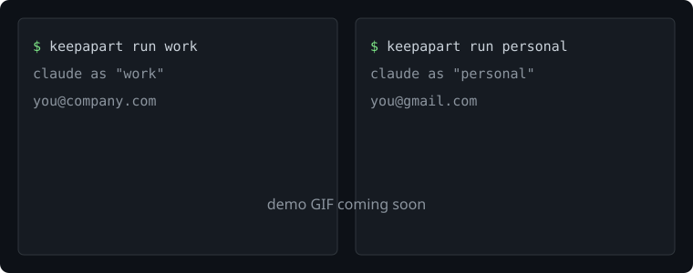
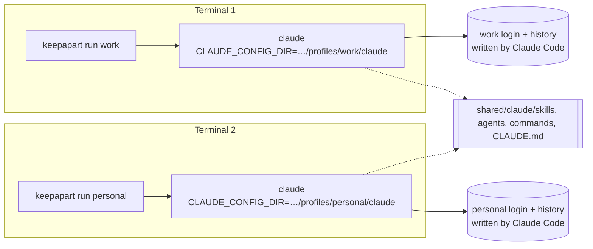

<div align="center">

# keepapart

**One machine, many Claude & Codex accounts. Work, personal, clients, kept apart.**

A single-binary CLI that gives each account its own Claude Code / Codex profile. The official CLIs handle the logins themselves. keepapart never touches your tokens.

[](https://github.com/moelsaka01/keepapart/actions/workflows/ci.yml)


[](LICENSE)

<!-- TODO: replace with assets/demo.gif: keepapart add work, then keepapart run work and keepapart run personal in two terminals, /status in each -->


</div>

> **Kept apart, not rate-limit hopping.** keepapart is for people who really have more than one account: an employer's Team seat and a personal Pro plan, or a separate login per client. It is **not** for rotating accounts to get around usage limits. It has no "switch when the limit is hit" feature and never will. Follow each provider's terms.

## The problem

Claude Code and Codex keep **one login per machine**. Supporting several accounts is one of the most-upvoted requests on [anthropics/claude-code#18435](https://github.com/anthropics/claude-code/issues/18435) (1,000+ 👍) and [openai/codex#4432](https://github.com/openai/codex/issues/4432). Until it ships:

- you **log out and in** every time you move from your employer's repo to a side project
- a client's code gets sent through **the wrong account** because you forgot which one is active
- your personal session history **mixes with work** history
- you can't run **work and personal side by side** in two terminals
- the existing switchers **copy your OAuth tokens around**, call usage endpoints with them, or need macOS

## What it does

| | |
|---|---|
| 🧱 **Isolated profiles** | Each profile is its own `CLAUDE_CONFIG_DIR` / `CODEX_HOME`: its own login, history and settings |
| 🔐 **Hands off your tokens** | You log in with `claude` / `codex login`. keepapart never reads, copies, exports or moves a credential, and never touches the keychain |
| 🪟 **Windows first-class** | Native `.exe`, PowerShell and cmd, Windows paths, and a junction or copy fallback when symlinks aren't allowed |
| 🖥️ **Side by side** | `keepapart run work` in one terminal, `keepapart run personal` in another. Each is its own process with its own environment |
| 📁 **Per-folder profiles** | `keepapart use client-acme` writes a `.keepapart` file, so that repo always uses the client account. You can commit it |
| 🔗 **Shared or per-profile config** | Skills, agents, commands and global instructions are shared by default; settings, plugins and Codex `config.toml` are your choice. Logins and history are never shared |
| 🐚 **Optional shell hook** | bash, zsh, fish and PowerShell: plain `claude` follows the folder you're in |
| 🩺 **`doctor`** | Checks installs, PATH, isolation, broken links and Windows symlink rights |
| 📦 **Settings export** | `export-config` writes settings only, with secret-looking values redacted |
| 🚫 **No network, no telemetry** | keepapart makes no network calls of its own. Not even an update check |

## Install

| OS | Command |
|---|---|
| Any (Rust) | `cargo install keepapart` |
| Windows | download `keepapart-*-x86_64-pc-windows-msvc.zip` from [Releases](https://github.com/moelsaka01/keepapart/releases), put `keepapart.exe` on your PATH |
| macOS / Linux | download the `.tar.gz` for your platform from [Releases](https://github.com/moelsaka01/keepapart/releases), put `keepapart` on your PATH |
| Scoop · Homebrew · winget | recipes are in [`packaging/`](packaging/); they go live with the first tagged release |

You also need the official CLIs you plan to use: [Claude Code](https://code.claude.com/docs/en/setup) and/or [Codex](https://developers.openai.com/codex/cli).

## Try it in 30 seconds

```bash
keepapart add work --tool both     # creates the profile, then runs `claude auth login` and `codex login`
keepapart add personal             # Claude only (the default)

keepapart run work                 # terminal 1: Claude Code as your work account
keepapart run personal             # terminal 2: Claude Code as your personal account, at the same time

cd ~/code/acme && keepapart use work    # this repo now always uses "work"
keepapart run                           # picks "work" here
keepapart                               # no arguments: pick a profile from a list and launch it
```

Pass arguments to the CLI after `--`: `keepapart run work -- --resume`, `keepapart run work --tool codex -- exec "fix the tests"`.

## Commands

| Command | What it does |
|---|---|
| `keepapart` | Pick a profile from a list and launch it |
| `add <name> [--tool claude\|codex\|both] [--isolated] [--no-login]` | Create a profile (or add a tool to one) and log in with the official CLI |
| `login <name> [--tool]` | Log in again, through the official CLI |
| `run [name] [--tool] [-- args]` | Launch `claude` / `codex` as that profile. With no name, uses the folder's profile |
| `use <name> [--global] [--clear]` | Pin a profile to this folder (`.keepapart`), or set the global default |
| `list` / `status` | Profiles, tools, login file present, last used; which profile applies here and why |
| `share <name> <item>…` / `unshare` / `shared` | Share items such as `claude:skills` between profiles, or keep them per profile |
| `rename <old> <new>` | Rename a profile. Its folders don't move, so its logins keep working |
| `remove <name>` | Delete a profile and its login files. Shared items are untouched |
| `export-config <name> [--out dir]` | Settings only, never logins, with secrets redacted |
| `doctor` | Check everything |
| `hook <bash\|zsh\|fish\|powershell>` | Print the shell hook |

Which profile applies, first match wins: the name you pass → `$KEEPAPART_PROFILE` → the nearest `.keepapart` file in this folder or a parent → the global default.

## How isolation works



keepapart sets **two documented variables** and starts the real CLI. That's all it does at launch:

```text
~/.keepapart/                      (or $KEEPAPART_HOME)
├── config.toml                    global default profile
├── profiles/
│   ├── work/
│   │   ├── profile.toml           name, tools, what's shared
│   │   ├── claude/                ← CLAUDE_CONFIG_DIR: login, history, projects, settings
│   │   │   └── skills → ../../../shared/claude/skills
│   │   └── codex/                 ← CODEX_HOME: auth, sessions, config.toml
│   └── personal/
│       └── claude/
└── shared/
    ├── claude/{skills,agents,commands,output-styles,CLAUDE.md}
    └── codex/{skills,prompts,AGENTS.md}
```

**Tested live on Windows 11** with Claude Code 2.1.322 and Codex 0.167.2: two logged-in profiles ran side by side, logging one out left the other signed in, and the machine's own `~/.claude` and `~/.codex` logins were untouched. Full log: [docs/windows-test.md](docs/windows-test.md).

Where each official CLI stores the login it creates, and why a separate folder keeps it separate (checked against current docs and source, November 2026):

| | Windows | macOS | Linux |
|---|---|---|---|
| **Claude Code** | `.credentials.json` in `CLAUDE_CONFIG_DIR` | Keychain entry **keyed to `CLAUDE_CONFIG_DIR`** ([docs](https://code.claude.com/docs/en/authentication)) | `.credentials.json` in `CLAUDE_CONFIG_DIR` |
| **Codex** | `auth.json` in `CODEX_HOME`, or the OS keyring | same | same |

Codex's keyring entry is named after a SHA-256 of the `CODEX_HOME` path ([`codex-rs/login/src/auth/storage.rs`](https://github.com/openai/codex/blob/main/codex-rs/login/src/auth/storage.rs)), so separate folders get separate entries even in keyring mode.

**Known limits, stated plainly:**

- A **Claude Console sign-in without an API key** is stored outside the config folder, per Anthropic's docs, so separate folders don't keep two of those apart. Subscription (claude.ai) logins and API keys are kept apart.
- `ANTHROPIC_API_KEY`, `ANTHROPIC_AUTH_TOKEN` or `CLAUDE_CODE_OAUTH_TOKEN` in your environment **override every profile**. `keepapart run` and `doctor` warn when one is set.
- Claude Code keeps **user-level MCP servers** in `.claude.json`, next to account data, so those stay per profile. To share an MCP server, use a plugin (`claude:plugins`) or a project `.mcp.json`. Codex MCP servers live in `config.toml`, which you can share (`codex:config.toml`).
- On macOS, `remove` deletes the profile folder but **leaves Claude Code's Keychain entry for it**, because keepapart never touches the Keychain. Delete it in Keychain Access if you want.

## Shared vs per-profile

```bash
keepapart shared                              # what can be shared, and who shares what
keepapart share work claude:settings.json     # use one settings.json for work and personal
keepapart unshare work claude:skills          # work gets its own copy of the skills from now on
```

| Item | Default | Notes |
|---|---|---|
| `claude:skills` `agents` `commands` `output-styles` `CLAUDE.md` | shared | |
| `claude:settings.json` `claude:plugins` | per profile | opt in with `share` |
| `codex:skills` `prompts` `AGENTS.md` | shared | |
| `codex:config.toml` `codex:rules` | per profile | `config.toml` includes MCP servers |
| logins, session history, projects | **always per profile** | not shareable. There is no code path that links or copies them |

The first profile to share an item seeds the shared copy. If two profiles both already have one, `share` refuses until you pass `--force`, and even then the old copy is kept as a backup, never deleted.

**On Windows**, a shared item is a symlink when Windows allows it (Developer Mode or admin). Otherwise shared folders use **junctions**, which need no special rights and stay live, and shared files are **copies** that `keepapart share` refreshes. `keepapart doctor` tells you which you have.

## Shell hook (optional)

Without the hook, use `keepapart run`. With it, plain `claude` and `codex` follow the folder's profile:

```bash
eval "$(keepapart hook bash)"                                  # ~/.bashrc
eval "$(keepapart hook zsh)"                                   # ~/.zshrc
keepapart hook fish | source                                   # ~/.config/fish/config.fish
```
```powershell
Invoke-Expression ((& keepapart hook powershell) -join "`n")   # notepad $PROFILE
```

The hook only sets or unsets `CLAUDE_CONFIG_DIR`, `CODEX_HOME` and `KEEPAPART_ACTIVE`, and only unsets variables it set itself. cmd.exe has no prompt hook, so use `keepapart run` there.

## Security

- **keepapart never reads, copies, exports or moves credentials.** Logins are created by the official CLI (`claude auth login`, `codex login`), in that profile's folder, by the CLI's own code.
- **It never touches the OS keychain** or the Windows Credential Manager.
- The only thing it checks about a login is **whether the login file exists** (for `list` / `doctor`). It never opens it.
- **No network calls, no telemetry, no update checks.** It doesn't show usage or limits, because that would mean using your token or calling unofficial endpoints. Run `/usage` in Claude Code or `/status` in Codex instead.
- **`export-config`** copies settings items only, drops any file named like a login, and replaces secret-looking values (`*KEY*`, `*TOKEN*`, `sk-…`, `ghp_…`, `Bearer …`) with `<redacted>`. A file it can't parse is skipped, not exported unchecked.
- **`remove`** refuses to delete anything outside `~/.keepapart/profiles/`, removes links before deleting, and asks first.

## Comparison

From each project's README on 2026-11-12. "—" means the README doesn't mention it. Corrections welcome: open an issue.

| | keepapart | [claude-swap](https://github.com/realiti4/claude-swap) | [clauth](https://github.com/uwuclxdy/clauth) | [clausona](https://github.com/larcane97/clausona) | [ccswap](https://github.com/errhythm/ccswap) | [swapdex](https://github.com/youdie006/swapdex) | [claude-switch](https://github.com/mtxr/claude-switch) |
|---|---|---|---|---|---|---|---|
| Claude Code | ✅ | ✅ | ✅ | ✅ | ✅ | ✅ | ✅ |
| Codex | ✅ | ➖ | ✅ | ✅ | ✅ | ✅ | ➖ |
| Windows without WSL | ✅ cmd + PowerShell | ✅ | Git Bash / MSYS2 | ✅ PowerShell | ✅ | ➖ WSL | ➖ WSL |
| How logins are kept | official CLI, own folder | stored backups, swapped in | snapshots of the credentials file | own folder | saved logins, switched | own folder (plus legacy snapshots) | official CLI, own folder |
| Uses your token for usage/quota | **never** | yes | yes | yes | yes | opt-in | not in README |
| Auto-switch near limits | **no, by design** | yes | yes | routes by quota | yes | optional | not in README |
| Per-folder profile | ✅ | — | — | ✅ | — | — | ✅ |
| Shared skills / config | ✅ | — | — | ✅ | — | — | — |
| Single binary | ✅ Rust | Python | ✅ Rust | Node/shell | Python | ✅ Rust | ✅ Zig |

Pick claude-swap, clauth or ccswap if you want usage dashboards. Pick keepapart if you want the smallest trust surface: nothing in it can touch a token, because nothing in it reads one.

## FAQ

**Is using several accounts allowed?**
Having separate accounts for separate purposes (an employer's seat and a personal plan, or a seat per client) is the normal case this tool is built for. Using extra accounts to get around usage limits is not, and keepapart won't help with it. Check each provider's terms for your situation.

**Which account is a profile signed in to?**
Ask the official CLI: `keepapart run work -- auth status --text` (Claude) or `keepapart run work --tool codex -- login status` (Codex).

**`claude` isn't found on Windows, but I just installed it.**
The native installer puts it in `%USERPROFILE%\.local\bin` and doesn't add that folder to PATH. `keepapart doctor` spots this and tells you which folder to add.

**Will this log me out of my normal `~/.claude`?**
No. keepapart never touches `~/.claude` or `~/.codex`. Plain `claude` keeps working as before unless you install the shell hook.

**Can I bring my existing skills and agents?**
Yes. Copy them into `~/.keepapart/shared/claude/skills` (or `agents`, `commands`) and every profile that shares them sees them.

**Does renaming a profile log it out?**
No. A profile's folder name is fixed when you create it, and `rename` only changes the display name. Moving the folder would break the macOS Keychain entry and the Codex keyring entry, which are keyed to the path.

**Does it work with the VS Code / JetBrains extensions or Claude Desktop?**
keepapart launches CLIs. An editor started from a terminal where the hook has set `CLAUDE_CONFIG_DIR` inherits it, but that's the editor's behavior, not something keepapart controls. Claude Desktop isn't covered.

**Why Rust?**
A single static binary with no runtime to install, which matters on Windows. It also starts in milliseconds, which matters for a shell hook that runs before every prompt.

**How do I uninstall?**
Delete the binary and `~/.keepapart`. Each profile's logins are inside its folder, except the macOS Keychain entries noted above.

## Development

```bash
cargo test                       # unit + end-to-end tests; uses stand-in claude/codex programs
cargo clippy --all-targets -- -D warnings
```

The end-to-end tests run the real binary against fake `claude` / `codex` executables found through PATH (`.cmd` on Windows). They check that each profile gets its own folder, that two profiles run at the same time without crossing, that logins can't be shared, that a removed profile never deletes shared content, and that the junction/copy fallback works. CI runs them on Windows, macOS and Ubuntu.

## License

[MIT](LICENSE) © Mohamed Elsaka
